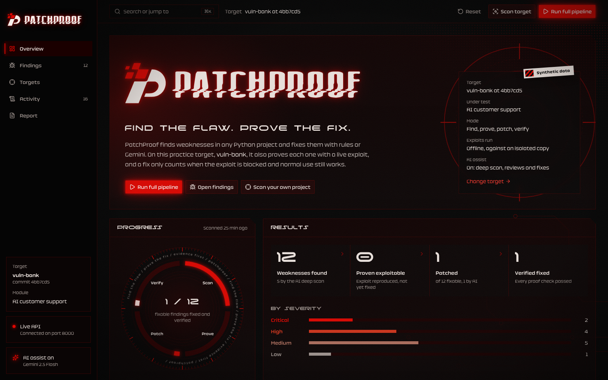
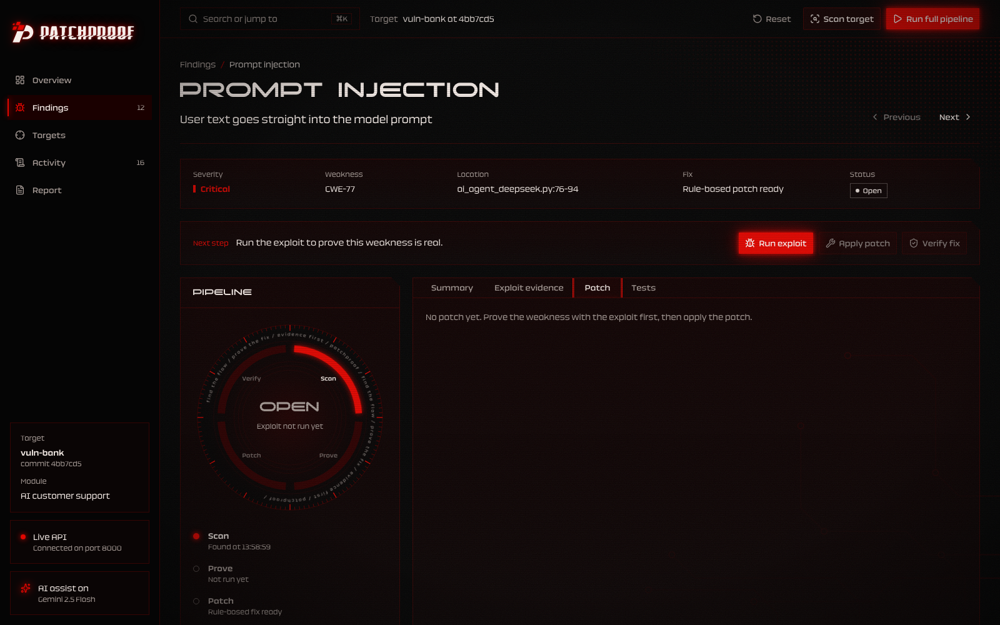
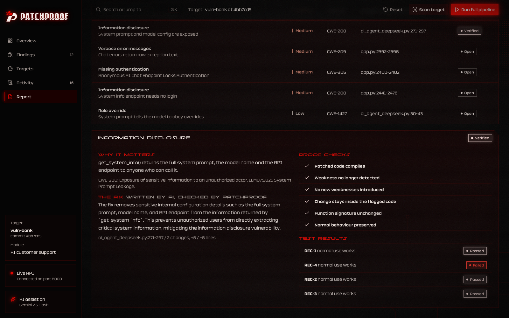

# PatchProof

**Find the flaw. Prove the fix.** PatchProof scans Python code for security weaknesses and fixes them. Nothing counts as fixed until it is proven:
- On practice apps, the original exploit is re-run and must be blocked, and the app's whole regression suite must still pass.
- On every fix, rule-based or written by Claude, the code must compile, the weakness must stop being detected, nothing new may be flagged, only the flagged code may change, and callers must keep working.

AI assistance (Claude or Gemini) is optional. It reviews findings, finds logic flaws that rules miss and writes fixes where no rule applies. Its output is always checked by the same proof checks; it is never trusted on its word.

<p align="center">
  
</p>

## Contents

- [How PatchProof meets the brief](#how-patchproof-meets-the-brief)
- [Targets](#targets)
- [Fixes, by type](#fixes-by-type)
- [Turn on AI (optional)](#turn-on-ai-optional)
- [Run it](#run-it)
- [How the proof works on practice apps](#how-the-proof-works-on-practice-apps)
- [Limits](#limits)
- [Layout](#layout)
- [Team](#team)

## How PatchProof meets the brief

| The brief asks | PatchProof | Where to check |
|---|---|---|
| Identify security weaknesses in deliberately vulnerable sample software | Any codebase in any common language: Python gets syntax-tree rules (16 types), and JavaScript/TypeScript, PHP, Java, Go, Ruby, C#, HTML templates and shell get pattern rules (60+). An optional AI deep scan reads every file for logic flaws such as broken access control. Rules need input to reach the sink; tests, dependencies, minified bundles and dev configs are skipped. Checked on DVWA (PHP), NodeGoat (Node.js), RailsGoat (Ruby), DSVW and vuln-bank. | [`engine/generic_rules.py`](engine/generic_rules.py), [`engine/lang_rules.py`](engine/lang_rules.py); a vulnerable and a safe case per rule in [`engine/tests/test_generic.py`](engine/tests/test_generic.py) and [`engine/tests/test_languages.py`](engine/tests/test_languages.py) |
| Propose or apply a defensive fix | Exact LibCST patches for 10 generic types and both vuln-bank golden-path types. On the whole vuln-bank repo (66 findings across Python, JavaScript and HTML), 44 get a rule-based fix and all 44 pass their checks. The AI model fixes the rest, in any language, when AI is on: in a live run, Gemini fixed and verified all 9 rule-less findings in vuln-bank and DSVW. **AI fix all** does a whole project in one click. Every fix is downloadable as one `.patch`. | [`engine/patcher.py`](engine/patcher.py), [`engine/tests/test_fixes.py`](engine/tests/test_fixes.py) |
| Validate that the fix stops the original exploit condition | Practice targets re-run every exploit case against the patched code; the weakness must also stop being detected by a rescan. | [`engine/verifier.py`](engine/verifier.py), [`engine/checks.py`](engine/checks.py), [`target_app/harness/cases.json`](target_app/harness/cases.json) |
| …while preserving expected application behaviour | The whole regression suite runs before (as a baseline) and after every fix. The static checks also require an unchanged signature and changes confined to the flagged function. REG-4 catches over-blocking fixes. | [`engine/checks.py`](engine/checks.py), REG-1 to REG-4 in [`target_app/SCOPE.md`](target_app/SCOPE.md) |
| AI is optional; accuracy and verification matter more than model complexity | Everything works without a key. Claude or Gemini can be used. With one, every AI output is gated: fixes must pass every check (up to 3 attempts, with the failed checks fed back), AI findings must quote real lines, and reviews are labelled as opinion. | [`engine/ai.py`](engine/ai.py), AI tests in [`engine/tests/test_fixes.py`](engine/tests/test_fixes.py) |
| Select a practice app or local fixture; document the precise in-scope files | vuln-bank pinned at `4bb7cd5`, and the notes-api fixture, each with exact in-scope files and lines | [`target_app/SCOPE.md`](target_app/SCOPE.md), [`target_app/profiles/`](target_app/profiles/) |
| At least two defensible weakness cases with evidence from source or executable tests | vuln-bank: prompt injection and broken authorization. notes-api: SQL injection and path traversal. All four are exploited live with recorded evidence (prompts, queries, leaked markers). | Exploit evidence tab; [`engine/tests/test_pipeline.py`](engine/tests/test_pipeline.py) |
| A minimal patch for at least one verified issue, then a regression/security test | Five verified fixes across the two practice apps. Each shows a unified diff and a per-case before/after table. | Patch and Tests tabs |
| Show severity rationale, exact code location, patch rationale and test status | Shown on every finding (Summary, Patch and Tests tabs) and in the Report (print or JSON) | [`frontend/src/pages/FindingPage.tsx`](frontend/src/pages/FindingPage.tsx), [`frontend/src/pages/ReportPage.tsx`](frontend/src/pages/ReportPage.tsx) |

<p align="center">
  
</p>

## Targets

Pick a target on the **Targets** page.

| Target | What you get |
|---|---|
| **vuln-bank** (default) | The whole deliberately vulnerable [vuln-bank](https://github.com/Commando-X/vuln-bank) app, pinned at `4bb7cd5`: Python, JavaScript and HTML. Its AI customer-support module is also proven with live exploits. |
| **notes-api** | A small deliberately vulnerable notes service in `target_app/fixtures/`. SQL injection and path traversal are exploited, fixed and verified. A hardcoded token is fixed and proven by the static checks and the regression suite. |
| **Your own project** | Any local folder or public `https://` Git repository. Every source file is scanned, whatever the language. **Your code is never run**, and your folder is never changed: fixes go to a copy, are proven by static checks, and download as one patch. |

### Fixes, by type

| Weakness | Rule-based fix |
|---|---|
| SQL injection | Bound parameters (`?` or `%s`, matching the driver the project uses), from f-strings, `+`, `%` and `.format` |
| Command injection | An argument list with no shell |
| Path traversal | A resolve-and-contain helper: paths outside the base folder are refused |
| SSRF | Only public http(s) addresses allowed, redirects not followed |
| Unverified JWT | Decoding with the key and algorithm the app signs with |
| Hardcoded secret | Read from the environment, with a reminder to rotate the old value |
| `eval`, `yaml.load`, `verify=False`, `debug=True` | `ast.literal_eval`, `yaml.safe_load`, certificate checks back on, debug only with `FLASK_DEBUG=1` |
| Anything else (`exec`, `pickle`, access control, weak hashing, LLM-agent issues) | The AI model, when AI is on |

## Turn on AI (optional)

```bash
cp .env.example .env     # then paste ANTHROPIC_API_KEY (Claude) or GEMINI_API_KEY (Gemini)
make api                 # restart the API so it reads .env
```

The sidebar shows **AI assist on** with the model name. Model defaults:
- Claude: Opus 5.5.
- Gemini: 2.5 Flash, about 5-30s per answer. Under load the newer Flash models took over a minute, so they are fallbacks for when 2.5 Flash is busy or out of quota.

`PATCHPROOF_AI_PROVIDER` chooses when both keys are set; `PATCHPROOF_AI_MODEL` pins a model. Then:
- **AI fix all**, **AI deep scan** and **AI review all** are on the Findings page. Fix all works through every open finding, one at a time, with rules first; each fix must pass every check.
- **Ask Claude/Gemini to review** is on each finding's Summary tab.
- **Generate AI fix** appears on findings no rule covers.

Run-all never calls the API.

## Run it

You need [uv](https://docs.astral.sh/uv/) and Node 20+.

```bash
uv sync                       # Python deps
(cd frontend && npm install)  # UI deps
make api                      # FastAPI on :8000
make web                      # dashboard on http://localhost:5173
```

In the dashboard:
1. Optional: open **Targets** to switch to notes-api, or to scan your own project.
2. Click **Run full pipeline**, or open a finding and step through it.
3. Use **Reset** to restore the original code and start again.

| Command | What it does |
|---|---|
| `make test` | Runs 138 engine and API tests. They cover every fix shape, the checks rejecting each kind of bad fix, and the AI path with a scripted model; no test calls the real API. |
| `VITE_USE_MOCKS=true make web` | Runs the UI on recorded sample data with no backend (AI off). |

## How the proof works on practice apps

- **Real code, offline.** Each practice app runs unmodified in a fresh, isolated interpreter (`python -I`) against synthetic data. For vuln-bank, Postgres is replaced by a fake database (alice, bob, admin), and DeepSeek by a *worst-case compliant model* that obeys any attacker text reaching it. For notes-api, the harness calls the app's functions directly.
- **Evidence, not vibes.** Every prompt and query is recorded. A case counts as exploited only when attacker instructions, another customer's data or a planted marker actually come back.
- **Before and after.** The exploit run records a baseline of the whole regression suite, so "before the patch" is evidence too.

<p align="center">
  
</p>

## Limits

- Rule-based (exact, mechanical) fixes exist for Python. Other languages are fixed by the AI model under language-neutral checks: syntax (where `node`, `php`, `ruby`, `bash` or `gofmt` is installed, else bracket balance), weakness gone on rescan, nothing new flagged, only the flagged lines changed.
- Pattern rules outside Python see one statement at a time; the AI deep scan covers flows across functions and files.
- Taint tracking follows one function, plus module helpers that pass a parameter into an HTTP request (such as DSVW's `FETCH`). Longer flows across functions or files can be missed; the AI deep scan exists for those.
- Gemini's free tier allows 20 requests per model per day. PatchProof spreads requests across many Flash models and says when they are all used up.
- Your own projects are never run. Their fixes are proven by static checks, not by exploits.
- AI features need an Anthropic or Gemini API key, and each review, fix or deep-scanned file is an API call.
- A regression case that already failed before a fix (vuln-bank's REG-4, until prompt injection is fixed) is reported as pre-existing, not blamed on the fix.

## Layout

```
engine/       scanner + rules (ast), patcher (LibCST), proof checks, verifier, harness runners, AI (optional)
backend/      FastAPI + TinyDB + BackgroundTasks; one job at a time; workspace copy under backend/data/
target_app/   target profiles, the pinned vuln-bank snapshot and the notes-api fixture (never edited), harnesses and cases
frontend/     React + Vite + Tailwind + shadcn/ui dashboard
```

## Team

Built in a 24-hour AppSec hackathon for problem statement **PS-02 — PatchProof: Find the Flaw. Prove the Fix.**, by a 3-person team working alongside AI coding agents under strict domain boundaries: engine, backend and frontend each owned by one person, with the schema, API contract and function signatures frozen in [`PROJECT_CONTEXT.md`](PROJECT_CONTEXT.md) so the three could move in parallel without colliding.

Contributors: [@Vaibhav-Reddy560](https://github.com/Vaibhav-Reddy560) · [@TrojanCoyote](https://github.com/TrojanCoyote)

The 2-minute walkthrough is in [`DEMO.md`](DEMO.md). Specs and contracts are in [`PROJECT_CONTEXT.md`](PROJECT_CONTEXT.md). Team and agent rules are in [`AGENT_RULES.md`](AGENT_RULES.md).
